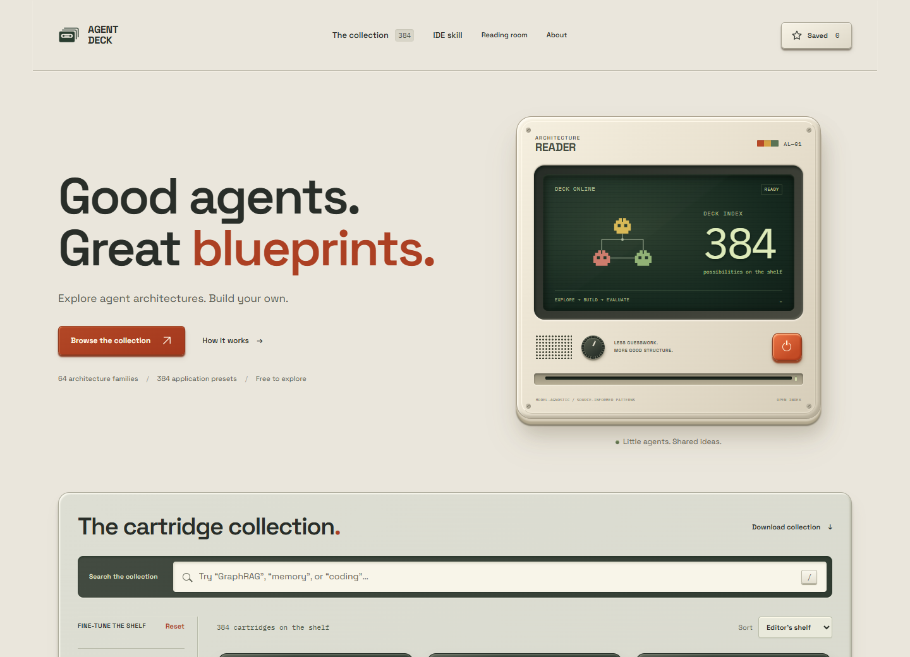

# Agent Deck

A free, source-attributed catalog of agent architecture blueprints, with an offline skill for AI coding tools.

**64 architecture families · 384 application presets · 53 references**

Explore agent architectures, inspect their contracts and adapt them to your own stack. The six application domains are research, coding, private knowledge, data analysis, writing and support.

**[Explore the website](https://eye172.github.io/agent-deck-1/)** · [Download the IDE skill](https://eye172.github.io/agent-deck-1/agent-deck-skill.zip) · [Deployment status](https://github.com/Eye172/agent-deck-1/actions/workflows/pages.yml)

## Explore and export

- Search with live facet counts, eight categories, 46 wiring labels and four complexity levels.
- Inspect interactive diagrams with distinct agents, tools, rules, context stores and human approval.
- Compare up to three presets and keep a local saved collection.
- Download full JSON blueprints, Markdown guides or the complete catalog.
- Follow primary sources and original authors in the reading room.

The interface uses a retro hardware palette, an upright architecture reader and cassette-style cartridges. Fonts are self-hosted; browsing requires no remote font service, model API or Agent Deck account.

## Use in your IDE

The production build includes **agent-deck-skill.zip**, an offline MIT skill containing all 384 canonical blueprints. Its read-only helper searches a compact index and loads only the selected contracts.

| Tool | Project skill folder | Invoke |
| --- | --- | --- |
| Codex | .agents/skills/agent-deck/ | $agent-deck |
| Cursor | .agents/skills/agent-deck/ or .cursor/skills/agent-deck/ | /agent-deck |
| Claude Code | .claude/skills/agent-deck/ | /agent-deck |
| VS Code / GitHub Copilot | .agents/skills/agent-deck/ or .github/skills/agent-deck/ | /agent-deck |

Extract the ZIP, copy the complete agent-deck folder to a supported project location and reload skills if needed. The helper needs Node.js 20+; there are no dependencies to install. No package account, server or API key is required. It uses the AI assistant already available in your tool.

Example request:

> Use Agent Deck to choose an architecture for my document assistant. Compare a simple baseline with one advanced alternative, then adapt the selected contract to my existing stack.

See [IDE installation and commands](docs/IDE_INTEGRATION.md). Official discovery paths have been reviewed; automatic invocation inside all four products has not been tested.

## Run locally

Requires Node.js 20 or newer; Node 24 is used in CI. No npm install is needed.

~~~sh
git clone https://github.com/Eye172/agent-deck-1.git
cd agent-deck-1
node scripts/serve.mjs
~~~

Open http://127.0.0.1:4187. The preview server builds the site before starting and binds to localhost. Stop it with Ctrl+C.

~~~sh
node --test tests/*.test.mjs
node scripts/build.mjs
~~~

The build publishes only **dist/**. It generates the website, 384 JSON blueprints, 384 Markdown guides, collection/source JSON, the IDE skill ZIP and its SHA-256 file. Generated output and local test artifacts are ignored by Git.

## What the catalog represents

The 384 entries are six original task adaptations of each mechanism family. They are not 384 independently validated architectures or new research claims. Families are editorial categories and can overlap.

Blueprints describe stages, predicates, state, tool adapters, failure routes, budgets, acceptance criteria and an evaluation plan. They are **design specifications**, not executable agents or drop-in LangGraph, CrewAI or AutoGen configurations. Model accuracy, latency and cost have not been benchmarked.

Diagrams show phase dependencies, logical actor identity, bounded worker capacity and illustrative search states. A skill invocation does not implement concurrency, durable memory or runtime enforcement.

Source authors remain credited in each preset. No ReasonMaxxer implementation, third-party reference photograph, trained model or dataset is redistributed.

## Website analytics

The published website can use Umami Cloud for page views and bounded catalogue actions. Search text, URL queries/fragments, blueprint settings and saved shelves are excluded. Local previews and the offline IDE skill do not send analytics. Browser privacy signals and the [privacy preference](https://eye172.github.io/agent-deck-1/privacy.html) are respected. See [configuration, events and verification](docs/ANALYTICS.md).

## Research supplement

[Research overview](https://eye172.github.io/agent-deck-1/research/index.html) · [Paper and open materials](research/README.md)

An AI-assisted companion study compares structural completion gates and role-staged workflows in small local models: **2,880 assigned attempts, 2,876 completed trials, four interrupted outcomes**, with **8,549 model calls** and **6,155,745 measured tokens** in completed trials. The 14-page working paper includes 18 references, raw evidence, 49 passing final apparatus tests and a successful offline analysis replay.

The tested environment contains six synthetic templates and two related Qwen 0.5B checkpoints. No correctness benefit from the structural gate was observed; task shortcuts, overlap and grading limitations are documented. This is a completed first series with planned follow-up work, not a benchmark of the catalogue's 64 families or 384 presets. Independent scientific review remains pending. The catalogue, its cards and the IDE skill are unchanged.

## Documentation

- [Research and original sources](docs/RESEARCH.md)
- [Complete mechanism taxonomy](docs/TAXONOMY.md)
- [Content and evaluation method](docs/CONTENT_METHOD.md)
- [IDE integration](docs/IDE_INTEGRATION.md)
- [Verification and limitations](docs/VERIFICATION.md)
- [Pre-deployment audit](docs/PREDEPLOY_AUDIT.md)
- [Publication and live verification](docs/PUBLICATION.md)
- [Hosting and GitHub Pages](docs/DEPLOYMENT.md)
- [Contributing](CONTRIBUTING.md)

## Development and publication

Source modules live in src/. Interface files are index.html, app.mjs, styles.css and assets/. The skill entrypoint and helper live in integrations/agent-deck; scripts/build-skill.mjs generates the complete portable package from the canonical catalog.

The GitHub Actions workflow tests and builds pull requests. Successful main-branch builds publish dist to GitHub Pages. Set **Settings → Pages → Source → GitHub Actions** when enabling publication.

Optional local browser checks use existing Playwright/Chromium installations specified through PLAYWRIGHT_MODULE and CHROMIUM_PATH. Set TEMP and TMP to your chosen workspace temporary directory; PREVIEW_URL defaults to http://127.0.0.1:4187. These scripts install no packages or browsers:

~~~sh
node scripts/browser-qa.mjs
node scripts/architecture-qa.mjs
node scripts/predeploy-qa.mjs
node scripts/skill-qa.mjs
~~~

They write reports, screenshots and downloads to output/. The skill's generated unpacked folder is output/skills/agent-deck. See the verification notes for tested coverage and limits.

## License and attribution

Original code and blueprint adaptations use the [MIT license](LICENSE). Space Grotesk and IBM Plex Mono use SIL OFL 1.1; their license files are retained. Original research and other cited works keep their own rights and licenses. See [third-party notices](THIRD_PARTY_NOTICES.md).

Maintained by [Eye172](https://github.com/Eye172).
